# CarbonTrack: Backend MRV Platform for Carbon Removal

[](https://github.com/your-username/carbon-track/actions/workflows/ci.yml)
[](https://www.python.org/)
[](https://fastapi.tiangolo.com)
[](https://www.sqlalchemy.org/)
[](https://www.postgresql.org/)
[]()
[](https://github.com/astral-sh/ruff)

CarbonTrack is a production-hardened backend platform for **Measurement, Reporting, and Verification (MRV)** of nature-based carbon removal projects (agroforestry, afforestation, and regenerative agriculture soil carbon).

It digitizes smallholder farmer onboarding, field monitoring observations, automated rule-based scientific data validation, and reproducible carbon credit calculations with immutable cryptographic audit trails.

---

## 1. Problem Statement & Context

The voluntary carbon market faces critical integrity challenges:
- **Greenwashing & Data Tampering:** Historical field monitoring records are frequently altered, backdated, or fabricated in spreadsheets without version control.
- **Double Counting:** Land parcels are often enrolled concurrently in multiple overlapping carbon credits programs without conflict resolution.
- **Irreproducible Estimates:** Carbon credits are frequently computed using opaque, hardcoded constants that cannot be reproduced years later by third-party auditors.
- **Manual Verification Bottlenecks:** Certifiers spend months manually verifying paper logs and inconsistent GPS plots.

### How CarbonTrack Solves This
1. **Append-Only Observation Lineage:** Observations cannot be updated or deleted (`HTTP 405`). Corrections must supersede prior observations, preserving the complete operational history.
2. **Deterministic & Versioned Carbon Engine:** All model constants live in versioned database methodologies. Every credit calculation persists an immutable `inputs_snapshot` containing exact observation IDs and methodology parameters, allowing auditors to reproduce numbers down to the exact decimal.
3. **Automated Scientific Validation Pipeline:** Pluggable validation rules (SOC physical ranges, tree mortality thresholds, future date detection, missing baselines) flag anomalous field data before calculations execute.
4. **Strict Concurrency & Overlap Prevention:** Database-level uniqueness and transaction checks prevent parcels from being concurrently enrolled in overlapping projects.
5. **Regulatory Audit Logging:** Every create, update, and state-change action logs an immutable audit trail (`who`, `what`, `before_state`, `after_state`, and `ip_address`).

---

## 2. System Architecture

```mermaid
flowchart TD
    Client["Client Applications / Mobile / Frontend"] -->|"HTTPS / JWT Bearer"| Security["Security & Ingress Layer"]

    subgraph Security ["Security & Ingress Layer"]
        RateLimit["Sliding Window Rate Limiter (10 auth/min, 60 api/min)"]
        CORS["CORS Middleware (Configured Allowed Origins)"]
        PayloadGuard["Payload Size Ceiling (Max 10 MB)"]
        ErrHandler["Global Sanitized Error Handlers (No 500 Leaks)"]
    end

    Security --> Router["FastAPI Routing Layer (/api/v1)"]

    subgraph Router ["FastAPI API Routers"]
        R_Auth["/auth (JWT, PBKDF2 Password Hashing)"]
        R_Farmers["/farmers (CRUD, Bulk CSV Import)"]
        R_Parcels["/parcels (Acreage, Soil, Crops)"]
        R_Projects["/projects (Afforestation, Regen Ag Lifecycle)"]
        R_Enrollments["/enrollments (Overlap Prevention)"]
        R_Obs["/observations (Append-Only Lineage)"]
        R_Carbon["/carbon (Automated MRV Estimations)"]
        R_Analytics["/analytics (SQL Window Aggregations, CSV)"]
        R_Jobs["/jobs (Async Background Import Status)"]
        R_Audit["/audit-logs (Immutable Regulatory Trail)"]
    end

    Router --> Services["Business Logic & Service Layer"]

    subgraph Services ["Domain Services & Calculation Engines"]
        ValPipeline["Pluggable Validation Pipeline (Rule Registry)"]
        CarbonEngine["Pure Functional Calculators (Afforestation & Soil Carbon)"]
        AsyncWorker["FastAPI BackgroundTasks Worker"]
        AuditService["Audit Trail Mutation Logger"]
    end

    Services --> DB[(PostgreSQL 16 Database)]

    subgraph DB ["PostgreSQL Persistence"]
        T_Users["users (RBAC: Admin, Field Officer, Verifier)"]
        T_Domain["farmers, land_parcels, projects, enrollments"]
        T_Obs["observations (Append-Only)"]
        T_Issues["validation_issues (Info, Warning, Error)"]
        T_Methodologies["methodologies (Versioned Parameters)"]
        T_Estimates["carbon_estimates (Immutable inputs_snapshot)"]
        T_Jobs["jobs (Async Import Lifecycle)"]
        T_Audit["audit_logs (Immutable Action History)"]
    end
```



---

## 3. Core Features & Capabilities

- **Role-Based Access Control (RBAC):** Three distinct roles (`admin`, `field_officer`, `verifier`) enforced via FastAPI dependency injection.
- **Bulk CSV Ingestion:** Resilient, row-by-row farmer ingestion where invalid rows report descriptive row numbers and diagnostic reasons without aborting valid rows.
- **Asynchronous Job Worker:** Decoupled background processing with status tracking via `GET /api/v1/jobs/{id}`.
- **Analytical Window Functions:** High-performance SQL aggregations for portfolio summaries and time-series cumulative net credit trajectory exports.
- **Structured JSON Logging:** Single-line, machine-readable JSON logs containing timestamps, loggers, correlation details, and exception traces.
- **98% Automated Test Coverage:** Over 145 unit, integration, and security tests running against SQLite and PostgreSQL in CI.

---

## 4. Quickstart: Local Development

### Prerequisites
- Python 3.11 or 3.12
- Git
- (Optional) Docker & Docker Compose

### 1. Clone & Set Up Virtual Environment
```bash
git clone https://github.com/your-username/carbon-track.git
cd carbon-track

python -m venv .venv
# On Windows (PowerShell):
.venv\Scripts\Activate.ps1
# On macOS / Linux:
source .venv/bin/activate
```

### 2. Install Project Dependencies
```bash
pip install --upgrade pip
pip install -e ".[dev]"
```

### 3. Configure Environment Variables
```bash
cp .env.example .env
```
Default `.env` settings will automatically run against a zero-config local SQLite database (`carbontrack.db`).

### 4. Run Migrations & Seed Default Data
```bash
# Run database migrations
alembic upgrade head

# Seed initial admin account and versioned carbon methodologies
python scripts/seed_admin.py
python scripts/seed_methodologies.py

# (Optional) Seed 500 realistic demo farmers, parcels, and observations
python scripts/seed_demo_data.py
```

### 5. Start Development Server
```bash
uvicorn app.main:app --reload --port 8000
```
- Interactive Swagger UI: [http://localhost:8000/docs](http://localhost:8000/docs)
- Interactive ReDoc: [http://localhost:8000/redoc](http://localhost:8000/redoc)
- Health Check: [http://localhost:8000/health](http://localhost:8000/health)

---

## 5. Running with Docker Compose (PostgreSQL 16)

To run the complete stack (FastAPI backend + PostgreSQL 16 database) in Docker containers:

```bash
docker-compose up --build
```
The Docker Compose setup includes:
- Isolated bridge network between API and Database.
- Automated `pg_isready` database health checks.
- API liveness health checks via `curl /health`.
- Persistent PostgreSQL volume storage (`postgres_data`).

---

## 6. Running Tests & Code Quality

```bash
# Run full test suite with coverage
python -m pytest --cov=app --cov-report=term-missing

# Run Ruff linter
python -m ruff check .

# Run Ruff code formatter check
python -m ruff format --check .
```

---

## 7. Cloud Deployment Guide

### Deploying to Render (Recommended PaaS)
This repository includes a native [`render.yaml`](render.yaml) blueprint specification for automated 1-click cloud deployment.

1. Fork or push this repository to your GitHub account.
2. Sign in to [render.com](https://render.com).
3. Click **Blueprints** → **New Blueprint Instance**.
4. Connect your GitHub repository.
5. Render will automatically:
   - Provision a managed **PostgreSQL 16 database** (`carbontrack-db`).
   - Provision a **FastAPI Web Service** (`carbontrack-api`).
   - Run `alembic upgrade head` and seeder scripts before booting Uvicorn.
6. Once deployed, open `https://<your-service>.onrender.com/docs`.

### Deploying to Railway
1. Sign in to [railway.com](https://railway.com).
2. Click **New Project** → **Provision PostgreSQL**.
3. In the same project, click **New** → **GitHub Repo** → select your CarbonTrack repo.
4. Set Build Command: `pip install -e . && pip install alembic`
5. Set Start Command: `alembic upgrade head && python scripts/seed_admin.py && python scripts/seed_methodologies.py && uvicorn app.main:app --host 0.0.0.0 --port $PORT`
6. Set Environment Variables:
   - `DATABASE_URL`: `${{Postgres.DATABASE_URL}}`
   - `ENVIRONMENT`: `production`
   - `SECRET_KEY`: *(Generate a 32+ character hex string)*
7. Under **Settings** → **Networking**, click **Generate Domain** to access your live API.

---

## 8. API Usage Examples

### 1. Authenticate & Obtain JWT Token
```bash
curl -X POST http://localhost:8000/api/v1/auth/login \
  -H "Content-Type: application/json" \
  -d '{"email": "admin@carbontrack.org", "password": "AdminPassword123!"}'
```
**Response:**
```json
{
  "access_token": "eyJhbGciOi...",
  "token_type": "bearer",
  "expires_in": 3600
}
```

### 2. Bulk Ingest Farmers via CSV
```bash
curl -X POST http://localhost:8000/api/v1/farmers/bulk-import \
  -H "Authorization: Bearer <TOKEN>" \
  -F "file=@farmers.csv"
```
**Response:**
```json
{
  "total_rows": 3,
  "imported_count": 2,
  "failed_count": 1,
  "errors": [
    {
      "row_number": 3,
      "field": "consent_given",
      "reason": "Consent is required under DPDP Act."
    }
  ]
}
```

### 3. Record an Append-Only Observation
```bash
curl -X POST http://localhost:8000/api/v1/observations \
  -H "Authorization: Bearer <TOKEN>" \
  -H "Content-Type: application/json" \
  -d '{
    "enrollment_id": 1,
    "type": "tree_count",
    "values": {"count": 450, "avg_height_m": 2.5},
    "observed_at": "2026-01-15T10:00:00Z",
    "is_baseline": false
  }'
```

### 4. Execute an Automated Carbon Estimation
```bash
curl -X POST http://localhost:8000/api/v1/carbon/estimate \
  -H "Authorization: Bearer <TOKEN>" \
  -H "Content-Type: application/json" \
  -d '{"enrollment_id": 1}'
```
**Response:**
```json
{
  "id": 1,
  "enrollment_id": 1,
  "methodology_version": "v1",
  "co2e_tonnes": 30.22,
  "uncertainty_pct": 0.10,
  "buffer_pct": 0.15,
  "net_credits": 23.12,
  "status": "draft",
  "computed_at": "2026-01-15T10:05:00Z"
}
```

---

## 9. Scientific Methodology & Calculations

CarbonTrack uses published carbon accounting equations parameterized by versioned database methodology records:

### 1. Afforestation Methodology (`Afforestation v1`)
$$\text{Biomass (tonnes)} = \frac{(\text{Current Trees} - \text{Baseline Trees}) \times \text{avg\_biomass\_kg}}{1000}$$
$$\text{Gross } \text{CO}_2\text{e} = \text{Biomass} \times \text{carbon\_fraction} (0.47) \times \frac{44}{12}$$

### 2. Soil Organic Carbon Methodology (`Soil Carbon v1`)
$$\text{SOC Stock (t C/ha)} = \text{SOC}\% \times \text{bulk\_density (g/cm}^3\text{)} \times \text{depth (cm)}$$
$$\Delta \text{SOC Stock} = \text{SOC Stock}_{\text{project}} - \text{SOC Stock}_{\text{baseline}}$$
$$\text{Gross } \text{CO}_2\text{e} = \Delta \text{SOC Stock} \times \frac{44}{12} \times (\text{area\_acres} \times 0.404686)$$

### 3. Risk Deductions & Net Issuance
$$\text{Net Credits} = \text{Gross } \text{CO}_2\text{e} \times (1 - \text{uncertainty\_pct}) \times (1 - \text{buffer\_pct})$$

> **Methodology Disclaimer:** CarbonTrack is an educational prototype. While calculations adhere strictly to standard stoichiometric conversion factors ($44/12$ for C to $\text{CO}_2$, $0.47$ carbon fraction of woody biomass), project methodologies in production registries (e.g., Verra VM0042, Gold Standard) require rigorous allometric tree species biomass equations and laboratory combustion analysis.

---

## 10. Limitations & Future Roadmap

- **Geospatial Boundaries (PostGIS):** Land parcels currently store acreage as numeric floating-point values. The planned upgrade introduces PostGIS polygon coordinates (`geometry(Polygon, 4326)`) and automated satellite overlap detection.
- **External Satellite Ingestion:** Observation entry is currently manual/API-driven. The roadmap includes automated Sentinel-2 NDVI vegetative index integration.
- **Distributed Caching:** Rate limiters currently operate in-process; production deployments spanning multiple container replicas should point to an external Redis cluster.

---

## 11. License

This project is licensed under the MIT License.
